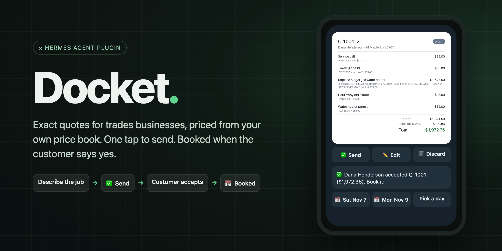
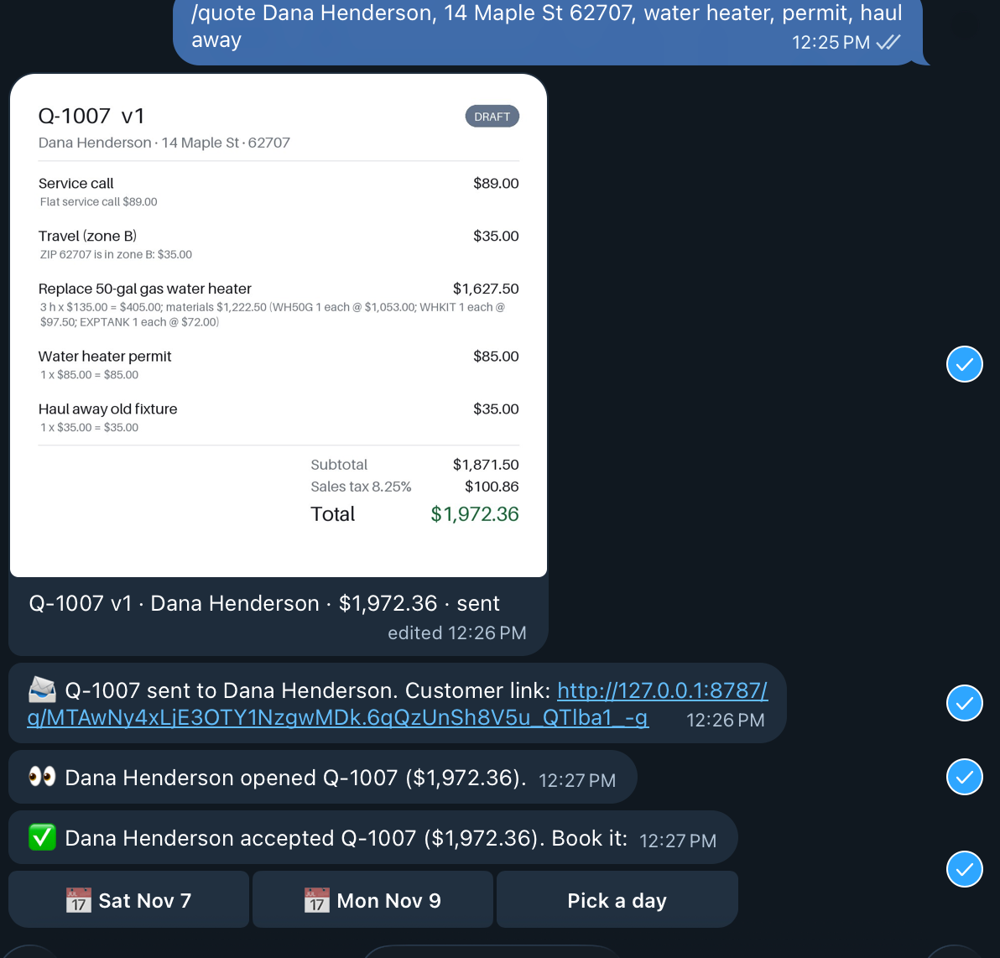
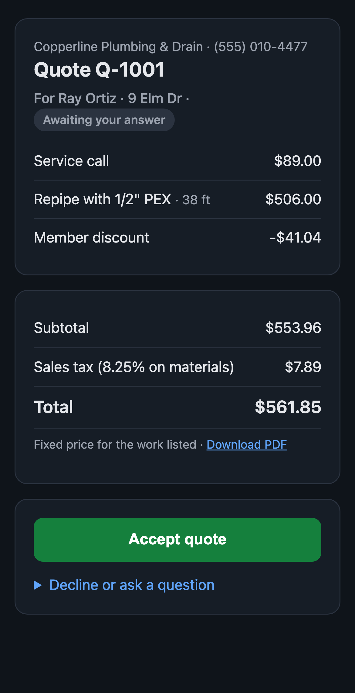
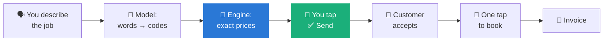
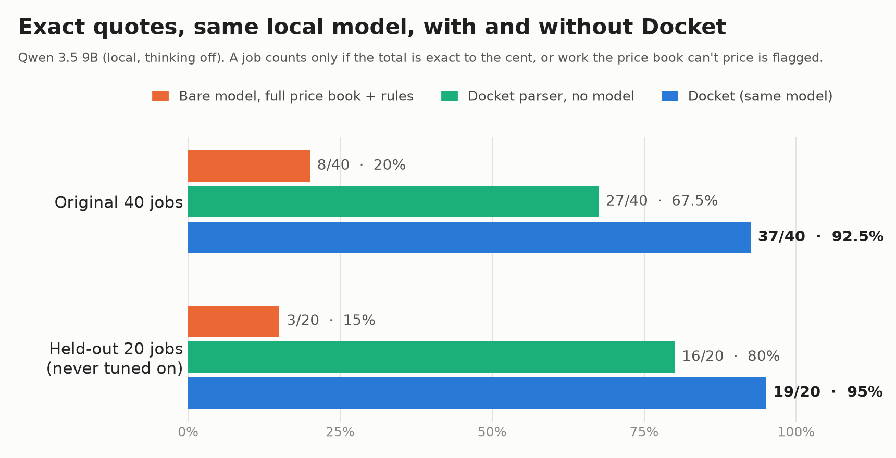
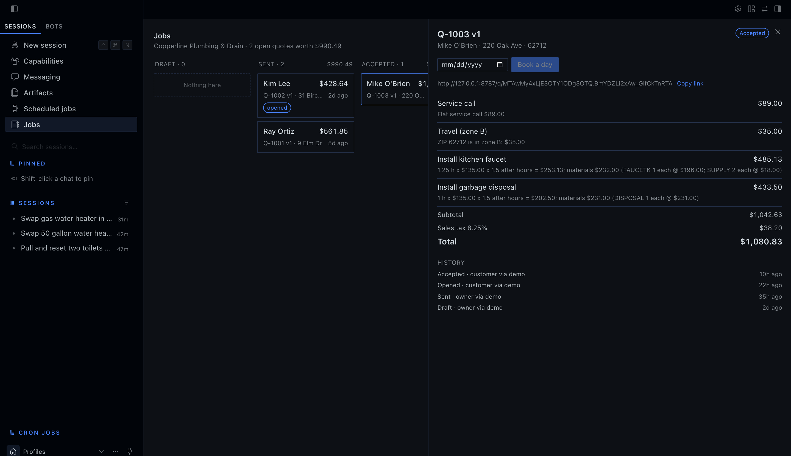
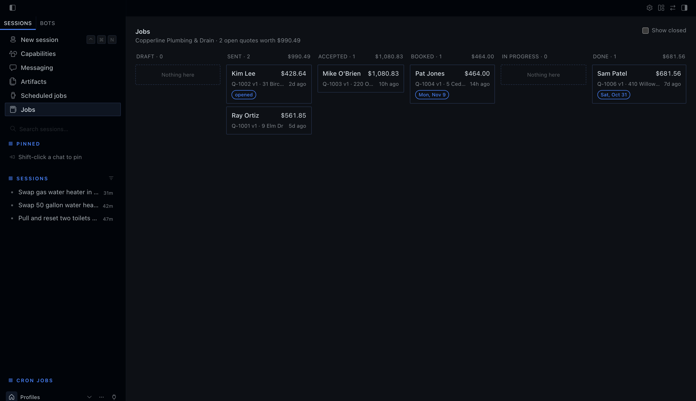
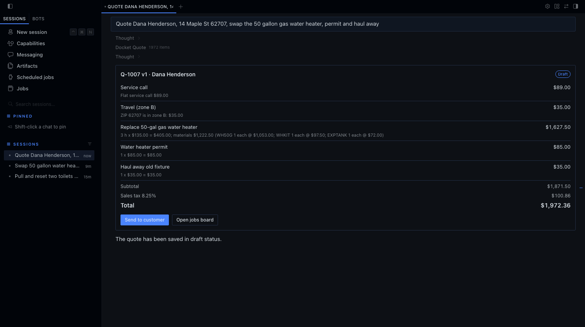
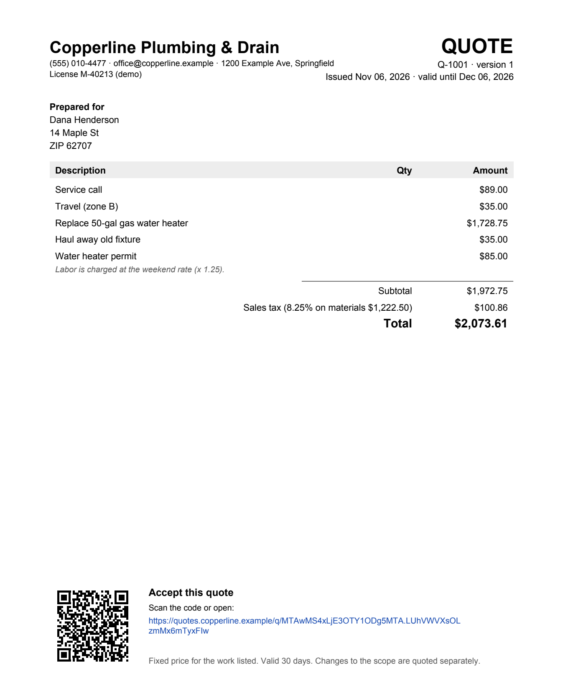
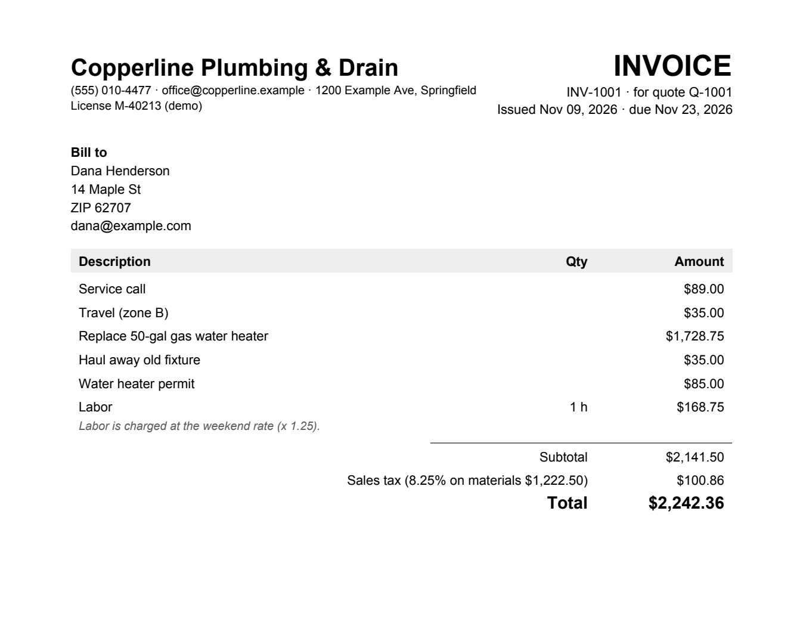

<p align="center">
  
</p>

<p align="center">
  <a href="https://hermes-agent.nousresearch.com"></a>
  
  
  
  <a href="LICENSE"></a>
</p>

<h3 align="center">Describe the job. Docket prices it from <em>your</em> price book, you tap ✅, the customer accepts, the job is booked.</h3>

---

**Docket** is a [Hermes Agent](https://hermes-agent.nousresearch.com) plugin for plumbers, electricians, handymen and anyone who quotes jobs from a price list. You describe the job the way you'd say it in the van. Docket turns the words into price-book items, **prices every line in code** (the model never produces a number), and sends you a quote card with buttons. Your customer gets a link to accept; you get pinged and book the day with one tap. When the job is done, Docket writes the invoice.

<table>
<tr>
<td width="56%" valign="top">

**On your phone (Telegram, live test)**



</td>
<td width="44%" valign="top">

**What your customer sees**



</td>
</tr>
</table>

## Contents

- [Try it in two minutes](#-try-it-in-two-minutes-no-accounts)
- [How it works](#-how-it-works)
- [Why a plugin and not a prompt](#-why-a-plugin-and-not-a-prompt)
- [A tour](#-a-tour)
- [Your price book](#-your-price-book)
- [Commands, tools and automations](#-commands-tools-and-automations)
- [Setup by surface](#-setup-by-surface)
- [Safety and disclosures](#-safety-and-disclosures)
- [Development](#-development)

---

## ⚡ Try it in two minutes (no accounts)

Docket ships a fictional demo company, **Copperline Plumbing & Drain**, so you can try the whole loop with no signups, keys or messaging apps. Everything runs on your machine.

```bash
hermes plugins install MKempler/docket --enable
hermes docket demo            # six customers, quotes in every state
```

Then start a **new** Hermes session (new plugins' tools load in the next session) and run:

```text
/quote Dana Henderson, 14 Maple St 62707, swap the 50 gallon gas water heater, permit and haul away
/quote send Q-1007            # prints the customer's accept link: open it, click Accept
/jobs                         # Q-1007 is now Accepted
/blueprint                    # Docket's three automations
```

| You should see | Example |
|---|---|
| A quote for **$1,972.36** with every line's pricing rule | `Replace 50-gal gas water heater: 3 h × $135.00 = $405.00; materials $1,222.50 …` |
| A customer page with **Accept quote** | served locally at `http://127.0.0.1:8787/q/…` |
| `/jobs` moving the job to **Accepted** | then `/quote book`, `/quote done`, `/quote paid` |

> [!TIP]
> In **Hermes Desktop**, open **Capabilities → Plugins** and switch on **Docket** to get the **Jobs** board in the sidebar. Desktop plugins ship switched off by Hermes's design.

---

## 🧭 How it works



**Five rules drive the design:**

1. **The model never produces a number.** It only maps words to price-book codes and quantities, through a schema with no money fields. Code does every calculation in exact decimals, rounded once per line.
2. **Nothing is guessed.** Work the price book can't price becomes a **needs-price** line, and a quote with one can't be sent. Lookalike jobs are caught too: *"tankless water heater"* is not the 50-gal gas swap.
3. **Nothing reaches a customer without your tap.** Buttons send directly with no model turn. If the agent tries to send, Hermes asks you first, and scheduled runs are **blocked** from sending.
4. **Every send is once and versioned.** A double tap sends once; revising a quote makes v2 and voids v1's customer link.
5. **Code checks what code can read.** ZIP codes, weekend / after-hours / emergency, membership and stated labor hours are read from your words by code, whatever the model says.

---

## 📊 Why a plugin and not a prompt

A prompt can describe a price book. It can't guarantee the arithmetic. We measured it on **60 messy, real-world job descriptions**, with the **same local model** both ways:

<p align="center"></p>

| | Original 40 jobs | Held-out 20 jobs (never tuned on) |
|---|---:|---:|
| Bare model, given the full price book and every pricing rule | 8 / 40 | 4 / 20 |
| Docket's built-in parser, no model at all | 22 / 40 | 13 / 20 |
| **Docket (same model, words → codes, code prices)** | **37 / 40** | **19 / 20** |

- **How a job is scored:** exact to the cent, or correctly flagged when the price book can't price the work.
- **What the bare model got wrong:** totals off by hundreds of dollars, and a confident **$579** for a job at a ZIP code the price book doesn't cover.
- **Docket's misses:** of its 4 across both sets, 3 were *safe* (an extra needs-price line that blocks sending until you look).
- **Reproduce it:** `python evals/run_eval.py` (any OpenAI-compatible endpoint). The job sets with hand-written ground truth and every raw result file are in [`evals/`](evals).

> [!NOTE]
> Model: Qwen 3.5 9B running locally in Ollama, thinking off. Bigger cloud models do better on their own, but the point stands: arithmetic belongs in code.

---

## 🖥️ A tour

### Hermes Desktop: the Jobs board

A live pipeline: **Draft → Sent → Accepted → Booked → In progress → Done**. It updates the moment a customer accepts or you tap a button on your phone. Click a card for every line, its pricing rule, the full history, the customer link and the next action.



<details>
<summary><b>More Desktop: the board, and quote cards inside chat</b></summary>
<br>

**The board**, with open-quote value in the status bar:



**Inline quote card.** Ask the agent for a quote in a Desktop chat and it shows up as a live card with a **Send** button, which updates itself when the quote is sent:



</details>

### Telegram and Slack

Run `/docket setup` once in your chat with Hermes (`!docket setup` on Slack). From then on:

- **Quote cards** arrive with **✅ Send · ✏️ Edit · 🗑 Discard**. After sending, the card redraws with a **SENT** badge.
- **Customer updates:** *"👀 Dana opened Q-1007"*, then *"✅ Dana accepted. Book it: [Sat Nov 7] [Mon Nov 9] [Pick a day]"*. Sundays are skipped.
- **Only you can press Docket's buttons**, even in a group chat.

### Quotes and invoices your customers receive

<table>
<tr>
<td width="50%" valign="top"><b>Quote PDF</b>: accept by QR code or link<br></td>
<td width="50%" valign="top"><b>Invoice PDF</b>: made when the job is done<br></td>
</tr>
</table>

### Close-out and invoicing

`/quote done Q-1007 plus 1 hour labor` finishes the job and makes **INV-1001**, priced by the same engine, extra work included. Docket stops where invoicing starts:

- **[Obol](https://github.com/UEddy/Obol) installed** and the customer has an email → the invoice goes to Obol as a **draft** (Obol's own approval rules apply).
- **Otherwise** → an invoice PDF and email land in Docket's outbox, ready for you to send.
- Extra work that can't be priced **blocks the invoice** instead of silently disappearing.

---

## 📒 Your price book

Everything Docket quotes comes from one YAML file you own. Run `/pricebook validate` after editing it; mistakes are reported with the line number.

```yaml
labor:
  rate: "135.00"           # per hour
  minimum_hours: "1.0"
multipliers:               # labor only; the highest flagged one wins
  after_hours: "1.5"
  weekend: "1.25"
  emergency: "2.0"
tax: { name: Sales tax, rate: "0.0825", applies_to: [materials] }

assemblies:                # jobs: labor + parts per unit
  WH50-REPLACE:
    name: Replace 50-gal gas water heater
    aliases: ["water heater", "heater swap"]          # how you actually say it
    exclude: ["tankless", "electric", "heat pump"]    # "not this job": becomes needs-price
    labor_hours: "3.0"
    materials: [{ code: WH50G, qty: "1" }, { code: WHKIT, qty: "1" }, { code: EXPTANK, qty: "1" }]

fees:
  HAULAWAY:
    name: Haul away old fixture
    amount: "35.00"
    limit_to: [WH50-REPLACE, TOILET-REPLACE, DISPOSAL-INSTALL, FAUCET-KITCHEN]   # one per replaced fixture
```

Also supported: travel zones by ZIP, member discounts (labor only), materials sold on their own, and fittings rounded up to whole units. See the full demo book in [`demo_data/pricebook.yaml`](demo_data/pricebook.yaml).

---

## 🧰 Commands, tools and automations

<table>
<tr><th>Slash command</th><th>What it does</th></tr>
<tr><td><code>/quote &lt;job in your words&gt;</code></td><td>Price a new job, then Send / Edit / Keep / Discard</td></tr>
<tr><td><code>/quote show | revise | send | discard Q-1007</code></td><td>Rules behind every line · <i>"make it Saturday"</i> → v2 · send once · discard</td></tr>
<tr><td><code>/quote book Q-1007 2026-11-12</code></td><td>Schedule an accepted job</td></tr>
<tr><td><code>/quote done Q-1007 [extra work]</code> · <code>/quote paid Q-1007</code></td><td>Invoice the finished job · mark it paid</td></tr>
<tr><td><code>/jobs [status]</code></td><td>Your pipeline, grouped by status with totals</td></tr>
<tr><td><code>/pricebook [validate]</code></td><td>Show or check your price book</td></tr>
<tr><td><code>/docket setup | demo | serve | link &lt;url&gt;</code></td><td>Owner chat · demo data · accept page · public link for customers</td></tr>
</table>

**Agent tools:** `docket_quote`, `docket_send_quote` *(asks you first; blocked under cron)*, `docket_price_preview`, `docket_jobs`, `docket_close_job`, `docket_followups`, `docket_run_sheet`, `docket_pipeline`.

**Automations** (in `/blueprint`, the Desktop Cron page and the dashboard):

| Blueprint | When | What you get |
|---|---|---|
| `docket:quote-followups` | weekday mornings | Quotes unanswered for N+ days, each with a ready-to-send nudge. **Never sends.** |
| `docket:run-sheet` | evenings | Tomorrow's jobs, addresses and the materials to load on the truck |
| `docket:weekly-pipeline` | Mondays | Open quote value, jobs won this week, win rate |

**CLI:** `hermes docket demo [--reset]` and `hermes docket serve`.

---

## 🔌 Setup by surface

| Surface | Status | How |
|---|---|---|
| **CLI** | ✅ verified | Works out of the box |
| **Hermes Desktop / Webapp** | ✅ verified | Capabilities → Plugins → switch **Docket** on, then restart the gateway once so the board's backend loads |
| **Telegram** | ✅ verified live | `hermes gateway setup` → Telegram, then send `/docket setup` to your bot |
| **Slack** | ✅ verified live | `hermes gateway setup` → Slack, then `!docket setup`. Use `!quote`, `!jobs`: Slack caps apps at 50 slash commands, and Hermes uses them all |
| **Discord** | 🧪 beta | Same buttons through Discord components; covered by tests, live check pending |
| **Other platforms** | ✅ | Slash commands and Hermes's own choice prompts |

**Customer links.** The accept page runs on your machine (`127.0.0.1:8787`, or the next free port). To let real customers reach it, put it behind a tunnel you control and run `/docket link https://your-tunnel.example`.

**Model.** Docket registers its own model slot, **Docket job intake**, with thinking off. Point it at a fast, cheap model in Hermes's Models settings if you like. Small local models work; if the model fails, Docket falls back to its built-in parser.

---

## 🔒 Safety and disclosures

| | |
|---|---|
| **Stored data** | Customers, quotes, events and invoices in a local SQLite file under `plugin-data/docket/`. It survives updates and reinstalls. |
| **Model calls** | Job descriptions go to the model you configured in Hermes, to map them to codes. Prices never come from the model. |
| **Network** | A local HTTP server for the customer accept page (loopback by default). Messages go only to *your* registered chat, through *your* bots. No telemetry. |
| **Email** | Docket does **not** send email. It writes the customer email and PDF to the outbox for you to send. |
| **Approvals** | A `pre_tool_call` gate asks before the agent sends a quote and blocks sends from scheduled runs. A `pre_llm_call` hook adds one line pointing the model at Docket's tools, only on messages about quoting. |
| **Payments** | None. Invoices are handed to Obol as drafts or kept as PDFs. |
| **Automations** | Blueprint jobs you schedule keep running after Docket is removed, until you delete them. |

---

## 🛠️ Development

```bash
git clone https://github.com/MKempler/docket && cd docket
uv venv .venv && uv pip install --python .venv/bin/python ruamel.yaml pytest "reportlab>=4.2,<6" "Pillow>=12,<14" \
    pypdf fastapi httpx "python-telegram-bot==22.8" "discord.py==2.7.1" "slack-bolt==1.30.0"
cd .. && docket/.venv/bin/python -m pytest -q docket/tests      # 82 tests
hermes plugins doctor docket --ci && hermes plugins validate docket --install-deps
```

| Area | Files |
|---|---|
| Pricing | `pricebook.py` (load, validate, line numbers) · `pricing.py` (exact engine) · `money.py` |
| Words → codes | `intake.py` (model path with guards, plus the deterministic parser) · `hints.py` |
| Ledger | `store.py` (versioned quotes, state machine, events) · `links.py` (signed, expiring links) |
| Flow | `service.py` · `invoices.py` · `reports.py` · `demo.py` |
| Surfaces | `commands.py` · `owner.py` + `channels.py` (Telegram / Slack / Discord) · `accept_server.py` · `dashboard/plugin_api.py` · `desktop/plugin.js` |
| Documents | `render.py` (quote and invoice PDFs, owner card) · `outbox.py` |

<p align="center"><sub>MIT licensed · Built for the Hermes Agent plugin hackathon · Copperline Plumbing & Drain is fictional</sub></p>
