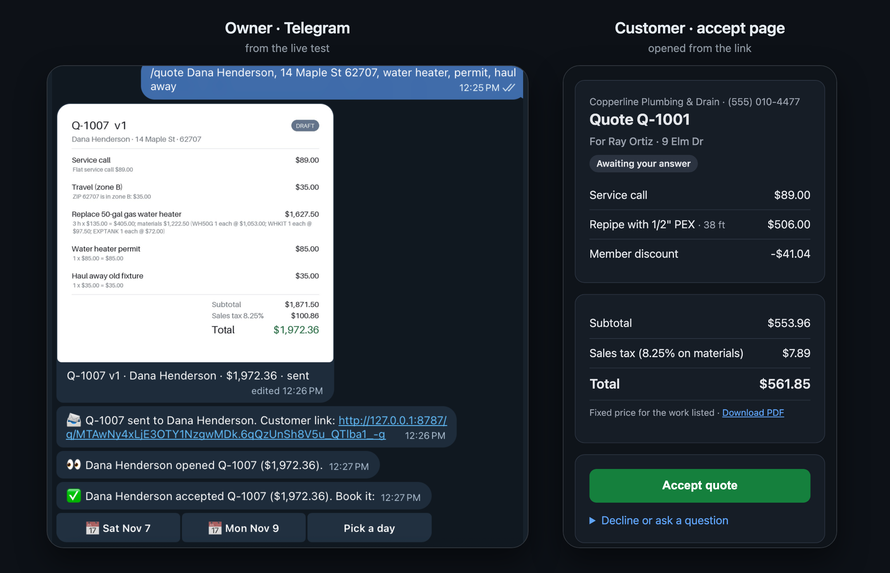
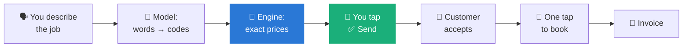
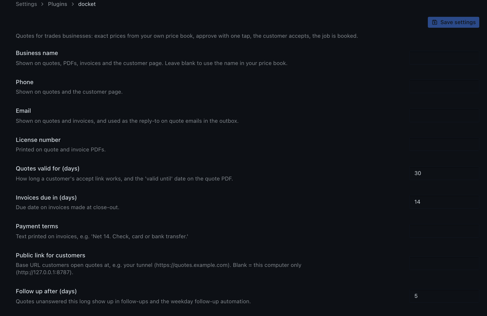
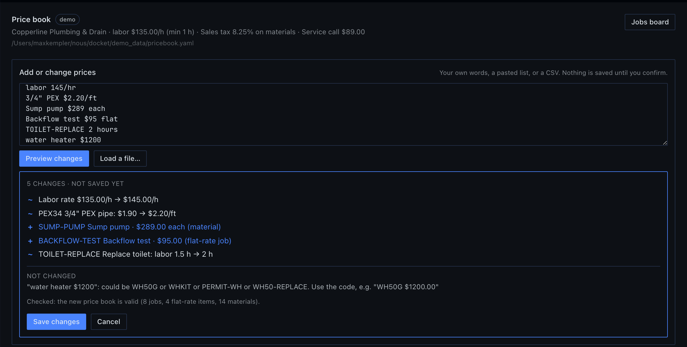

<p align="center">
  
</p>

<p align="center">
  <a href="https://hermes-agent.nousresearch.com"></a>
  
  <a href="https://github.com/MKempler/docket/actions/workflows/tests.yml"></a>
  
  <a href="LICENSE"></a>
</p>

<h3 align="center">Describe the job. Docket prices it from <em>your</em> price book, you tap ✅, the customer accepts, the job is booked.</h3>

---

**Docket** is a [Hermes Agent](https://hermes-agent.nousresearch.com) plugin for plumbers, electricians, handymen and anyone who quotes jobs from a price list. You describe the job the way you'd say it in the van. Docket turns the words into price-book items, **prices every line in code** (the model never produces a number), and sends you a quote card with buttons. Your customer gets a link to accept; you get pinged and book the day with one tap. When the job is done, Docket writes the invoice.

<p align="center">
  
</p>

## Contents

- [Try it in two minutes](#-try-it-in-two-minutes-no-accounts)
- [How it works](#-how-it-works)
- [Why a plugin and not a prompt](#-why-a-plugin-and-not-a-prompt)
- [Quote from a voice note](#-quote-from-a-voice-note)
- [A tour](#-a-tour)
- [Your price book](#-your-price-book)
- [Commands, tools and automations](#-commands-tools-and-automations)
- [Setup by surface](#-setup-by-surface)
- [Safety and disclosures](#-safety-and-disclosures)
- [Development](#-development)

---

## ⚡ Try it in two minutes (no accounts)

Docket ships a fictional demo company, **Copperline Plumbing & Drain**, so you can try the whole loop with no signups, keys or messaging apps. Everything runs on your machine.

```bash
hermes plugins install MKempler/docket --enable    # answer "y" to install its two libraries (reportlab, Pillow)
hermes docket demo                                 # six customers, quotes in every state
```

Then start a **new** Hermes session (new plugins' tools load in the next session) and run:

```text
/quote Dana Henderson, 14 Maple St 62707, swap the 50 gallon gas water heater, permit and haul away
/quote send Q-1007            # prints the customer's accept link: open it, click Accept
/jobs                         # Q-1007 is now Accepted
/blueprint                    # Docket's three automations
```

| You should see | Example |
|---|---|
| A quote for **$1,972.36** with every line's pricing rule | `Replace 50-gal gas water heater: 3 h × $135.00 = $405.00; materials $1,222.50 …` |
| A customer page with **Accept quote** | served locally at `http://127.0.0.1:8787/q/…` |
| `/jobs` moving the job to **Accepted** | then `/quote book`, `/quote done`, `/quote paid` |

> [!TIP]
> In **Hermes Desktop**, open **Capabilities → Plugins** and switch on **Docket**, then run `hermes gateway restart` once so its backend loads. You get **Jobs** and **Price book** in the sidebar. Desktop plugins ship switched off by Hermes's design.

---

## 🧭 How it works



**Five rules drive the design:**

1. **The model never produces a number.** It only maps words to price-book codes and quantities, through a schema with no money fields. Code does every calculation in exact decimals, rounded once per line.
2. **Nothing is guessed.** Work the price book can't price becomes a **needs-price** line, and a quote with one can't be sent. Lookalike jobs are caught too: *"tankless water heater"* is not the 50-gal gas swap.
3. **Nothing reaches a customer without your tap.** Buttons send directly with no model turn. If the agent tries to send, Hermes asks you first, and scheduled runs are **blocked** from sending.
4. **Every send is once and versioned.** A double tap sends once; revising a quote makes v2 and voids v1's customer link.
5. **Code checks what code can read.** ZIP codes, weekend / after-hours / emergency, membership and stated labor hours are read from your words by code, whatever the model says.

---

## 📊 Why a plugin and not a prompt

A prompt can describe a price book. It can't guarantee the arithmetic. We measured it on **60 messy, real-world job descriptions**, with the **same local model** both ways:

<p align="center"></p>

| | Original 40 jobs | Held-out 20 jobs (never tuned on) |
|---|---:|---:|
| Bare model, given the full price book and every pricing rule | 8 / 40 | 3 / 20 |
| Docket's built-in parser, no model at all | 27 / 40 | 16 / 20 |
| **Docket (same model, words → codes, code prices)** | **37 / 40** | **19 / 20** |

- **How a job is scored:** exact to the cent, or correctly flagged when the price book can't price the work.
- **What the bare model got wrong:** totals off by hundreds of dollars, and a confident **$1,815.74** for a water heater at a ZIP code the price book doesn't cover.
- **Docket's misses:** all 4 across both sets were *safe*: the total was right, but Docket added a needs-price line that blocks sending until you look.
- **Reproduce it:** `python evals/run_eval.py` (any OpenAI-compatible endpoint), then `python evals/make_chart.py` redraws this chart from the result files. (The parser row was re-scored with `--parser-only` after a fix to how it reads counts like *"reset 2 toilets"*; that file is in `evals/results/` too.) The job sets with hand-written ground truth and every raw result file are in [`evals/`](evals).

> [!NOTE]
> Model: Qwen 3.5 9B running locally in Ollama, thinking off. Bigger cloud models do better on their own, but the point stands: arithmetic belongs in code.

---

## 🎙️ Quote from a voice note

Standing in a basement with wet hands? Hold the mic in Telegram and say the job:

> *"Dana Henderson, fourteen Maple Street, six two seven oh seven. Swap the fifty gallon gas water heater, permit, and haul away the old one."*

Hermes echoes what it heard, and the priced quote card follows: **$1,972.36**, the same as typing it. Docket adds three things to Hermes's built-in transcription:

- **It teaches the recognizer your trade.** A `pre_transcription` hook hands Whisper your own price book's words (*PEX, P-trap, angle stop, expansion tank* and the names you use for jobs), so they come out spelled the way the price book spells them. It updates itself when you change your prices.
- **It reads numbers the way people say them.** *"six two seven oh seven"*, a transcript's *"627-07"* and *"an hour and a half"* become `62707` and `1.5 hours` before anything is priced.
- **It catches misheard names.** If Whisper hears *"Denahenderson"* at a ZIP where you already have a *Dana Henderson*, the quote goes to Dana (with a note saying so). It never matches across ZIPs.

Docket still prices only what the transcript names. A word Whisper drops is a line missing from the card you check before sending, never a guessed one.

**Measured.** Every job spoken aloud by three macOS voices, transcribed with Hermes's own local Whisper settings, then quoted. The voice set is 20 jobs written the way people talk and [committed before any voice results existed](evals/jobs_voice20.yaml), never tuned on:

| Voice held-out set (20 jobs) | Whisper `base` (Hermes default) | Whisper `small.en` |
|---|---:|---:|
| Plain transcription | 15 / 20 | 16 / 20 |
| **With Docket's vocabulary hint** | **17 / 20** | **18 / 20** |

Of the 3 misses with Whisper `base`, two were safe (a dropped ZIP or a misheard word made Docket flag the quote instead of guessing); one lost a spoken *"extra hour and a half of labor"*, a line missing from the card you check before sending. Synthetic voices are cleaner than a real one in a noisy basement, so read these as the pipeline's ceiling. On a development set, the vocabulary hint alone lifted Docket from 12/20 to 16/20, and the spoken-number handling took it to 19/20. Reproduce: `python evals/run_voice_eval.py --jobs jobs_voice20.yaml --whisper base` (macOS, for `say`).

**Setup:** voice notes need Hermes's local Whisper: `hermes pm install --extra stt-whisper`, then restart the gateway. For better accuracy, set `stt.local.model: small.en` in `config.yaml`.

---

## 🖥️ A tour

### Hermes Desktop: the Jobs board

A live pipeline: **Draft → Sent → Accepted → Booked → In progress → Done**. It updates the moment a customer accepts or you tap a button on your phone. Click a card for every line, its pricing rule, the full history, the customer link and the next action.


<details>
<summary><b>More Desktop: the board, and quote cards inside chat</b></summary>
<br>

**The board**, with open-quote value in the status bar:


**Inline quote card.** Ask the agent for a quote in a Desktop chat and it shows up as a live card with a **Send** button, which updates itself when the quote is sent:


</details>

### Telegram, Slack and Discord

Run `/docket setup` once in your chat with Hermes (`!docket setup` on Slack). From then on:

- **Quote cards** arrive with **✅ Send · ✏️ Edit · 🗑 Discard**. After sending, the card redraws with a **SENT** badge.
- **A message ready for the customer** follows as its own chat message (*"Hi Dana, here's your quote from Copperline… $1,972.36. See every line and accept it here: …"*). Long-press it and forward it by text, WhatsApp or email. In Desktop it's copied to your clipboard when you press Send, and shown on the quote with a Copy button.
- **Customer updates:** *"👀 Dana opened Q-1007"*, then *"✅ Dana accepted. Book it: [Sat Nov 7] [Mon Nov 9] [Pick a day]"*. Sundays are skipped.
- **Only you can press Docket's buttons**, even in a group chat.

### Settings, in Hermes's own Settings screen

Business name, phone, email and license number, how long quotes stay valid, invoice due days, payment terms, the public link for customers and when to follow up all live in **Settings → Plugins → docket**. Nothing to edit by hand.



### Quotes and invoices your customers receive

<table>
<tr>
<td width="50%" valign="top"><b>Quote PDF</b>: accept by QR code or link<br></td>
<td width="50%" valign="top"><b>Invoice PDF</b>: made when the job is done<br></td>
</tr>
</table>

### Close-out and invoicing

`/quote done Q-1007 plus 1 hour labor` finishes the job and makes **INV-1001**, priced by the same engine, extra work included. Docket stops where invoicing starts:

- **[Obol](https://github.com/UEddy/Obol) installed** and the customer has an email → the invoice goes to Obol as a **draft** (Obol's own approval rules apply).
- **Otherwise** → an invoice PDF and email land in Docket's outbox, ready for you to send.
- Extra work that can't be priced **blocks the invoice** instead of silently disappearing.

---

## 📒 Your price book

Everything Docket quotes comes from one YAML file you own. You never have to open it.

### Change it in your own words

Type a change, paste a whole price list, or load a CSV from your supplier or old spreadsheet. Docket shows exactly what would change and saves **only when you confirm**:

```text
/pricebook add labor 145/hr, 3/4" PEX $2.20/ft, Sump pump $289 each, Backflow test $95 flat
/pricebook add TOILET-REPLACE 2 hours
/pricebook import ~/Downloads/supplier-prices.csv
/pricebook undo
```



- **No invented prices.** Every price must appear, digit for digit, in what you typed. A model reads only the chatty lines a plain reader can't (*"toilets are 350 flat and 3/4 pex is 2.20 a foot"*), and any number it returns that you didn't write is refused and reported.
- **No guesses.** A line that could mean several items is left unchanged, listing the candidates, as in `water heater $1200` above.
- **Your file stays yours.** Edits change only the affected lines; your comments and layout are kept. Every save is re-validated and backed up, so `/pricebook undo` puts it back.
- **Same flow everywhere.** A preview card with ✅ Save / Cancel on Telegram, Slack and Discord; the **Price book** page in Desktop; or just tell the agent (*"raise my labor rate to $150"*). Agent saves go through Hermes's approval prompt, which lists Docket's own record of the changes, are blocked in scheduled runs, and previews expire after 30 minutes. Asking the agent depends on your model calling the tool; `/pricebook add` and the Desktop page don't. Starting from scratch: `/pricebook new Rivera Plumbing, labor 120/hr, tax 7%`.

### What's in it

If you edit the file by hand, run `/pricebook validate` afterwards; mistakes are reported with the line number.

```yaml
labor:
  rate: "135.00"           # per hour
  minimum_hours: "1.0"
multipliers:               # labor only; the highest flagged one wins
  after_hours: "1.5"
  weekend: "1.25"
  emergency: "2.0"
tax: { name: Sales tax, rate: "0.0825", applies_to: [materials] }

assemblies:                # jobs: labor + parts per unit
  WH50-REPLACE:
    name: Replace 50-gal gas water heater
    aliases: ["water heater", "heater swap"]          # how you actually say it
    exclude: ["tankless", "electric", "heat pump"]    # "not this job": becomes needs-price
    labor_hours: "3.0"
    materials: [{ code: WH50G, qty: "1" }, { code: WHKIT, qty: "1" }, { code: EXPTANK, qty: "1" }]

fees:
  HAULAWAY:
    name: Haul away old fixture
    amount: "35.00"
    limit_to: [WH50-REPLACE, TOILET-REPLACE, DISPOSAL-INSTALL, FAUCET-KITCHEN]   # one per replaced fixture
```

Also supported: travel zones by ZIP, member discounts (labor only), materials sold on their own, and fittings rounded up to whole units. See the full demo book in [`demo_data/pricebook.yaml`](demo_data/pricebook.yaml).

---

## 🧰 Commands, tools and automations

<table>
<tr><th>Slash command</th><th>What it does</th></tr>
<tr><td><code>/quote &lt;job in your words&gt;</code></td><td>Price a new job, then Send / Edit / Keep / Discard</td></tr>
<tr><td><code>/quote show | revise | send | discard Q-1007</code></td><td>Rules behind every line · <i>"make it Saturday"</i> → v2 · send once · discard</td></tr>
<tr><td><code>/quote book Q-1007 2026-11-12</code></td><td>Schedule an accepted job</td></tr>
<tr><td><code>/quote done Q-1007 [extra work]</code> · <code>/quote paid Q-1007</code></td><td>Invoice the finished job · mark it paid</td></tr>
<tr><td><code>/jobs [status]</code></td><td>Your pipeline, grouped by status with totals</td></tr>
<tr><td><code>/pricebook [validate]</code></td><td>Show or check your price book</td></tr>
<tr><td><code>/pricebook add | import | remove | alias | undo | new</code></td><td>Change prices in your own words or from a CSV: preview first, then save</td></tr>
<tr><td><code>/docket setup | demo | serve | link &lt;url&gt;</code></td><td>Owner chat · demo data · accept page · public link for customers</td></tr>
</table>

**Agent tools:** `docket_quote`, `docket_send_quote` *(asks you first; blocked under cron)*, `docket_pricebook_edit` *(preview only)*, `docket_pricebook_save` *(asks you first; blocked under cron)*, `docket_price_preview`, `docket_jobs`, `docket_close_job`, `docket_followups`, `docket_run_sheet`, `docket_pipeline`.

**Automations** (in `/blueprint`, the Desktop Cron page and the dashboard):

| Blueprint | When | What you get |
|---|---|---|
| `docket:quote-followups` | weekday mornings | Quotes unanswered for N+ days, each with a ready-to-send nudge. **Never sends.** |
| `docket:run-sheet` | evenings | Tomorrow's jobs, addresses and the materials to load on the truck |
| `docket:weekly-pipeline` | Mondays | Open quote value, jobs won this week, win rate |

**CLI:** `hermes docket demo [--reset]` and `hermes docket serve`.

---

## 🔌 Setup by surface

| Surface | Status | How |
|---|---|---|
| **CLI** | ✅ verified | Works out of the box |
| **Hermes Desktop / Webapp** | ✅ verified | Capabilities → Plugins → switch **Docket** on, then restart the gateway once so the board's backend loads |
| **Telegram** | ✅ verified live | `hermes gateway setup` → Telegram, then send `/docket setup` to your bot. Voice notes: `hermes pm install --extra stt-whisper` |
| **Slack** | ✅ verified live | `hermes gateway setup` → Slack, then `!docket setup`. Use `!quote`, `!jobs`: Slack caps apps at 50 slash commands, and Hermes uses them all |
| **Discord** | ✅ verified live | `hermes gateway setup` → Discord, add the bot to a server you're in (Discord only lets bots DM people they share a server with), then `/docket setup` |
| **Other platforms** | ✅ | Slash commands and Hermes's own choice prompts |

**Customer links.** The accept page runs on your machine (`127.0.0.1:8787`, or the next free port). To let real customers reach it, put it behind a tunnel you control and set **Public link for customers** in Settings → Plugins → docket (or run `/docket link https://your-tunnel.example`).

**Model.** Docket registers its own model slot, **Docket job intake**, with thinking off. Point it at a fast, cheap model in Hermes's Models settings if you like. Small local models work; if the model fails, Docket falls back to its built-in parser.

---

## 🔒 Safety and disclosures

| | |
|---|---|
| **Stored data** | Customers, quotes, events and invoices in a local SQLite file under `plugin-data/docket/`. It survives updates and reinstalls. |
| **Model calls** | Job descriptions go to the model you configured in Hermes, to map them to codes. Price lists it can't read plainly go to the same model. Prices never come from the model: an imported price must appear in your own words. |
| **Voice notes** | Transcribed by Hermes's speech-to-text (local Whisper by default). Docket's `pre_transcription` hook adds your price book's item names and aliases to the transcription prompt; if you configured a cloud speech provider, that prompt goes to it with the audio. |
| **Network** | A local HTTP server for the customer accept page (loopback by default). Messages go only to *your* registered chat, through *your* bots. No telemetry. |
| **Email** | Docket does **not** send email or texts. It writes the customer email and PDF to the outbox, and hands you a ready-to-forward message; you choose how it reaches the customer. It warns you when a customer link would only open on your own computer. |
| **Approvals** | A `pre_tool_call` gate asks before the agent sends a quote or saves a price book change (listing the exact changes), and blocks both from scheduled runs. A `pre_llm_call` hook adds one line pointing the model at Docket's tools, only on messages about quoting or your price book. |
| **Payments** | None. Invoices are handed to Obol as drafts or kept as PDFs. |
| **Automations** | Blueprint jobs you schedule keep running after Docket is removed, until you delete them. |

---

## 🛠️ Development

```bash
git clone https://github.com/MKempler/docket && cd docket
uv venv .venv && uv pip install --python .venv/bin/python -r requirements-dev.txt
.venv/bin/python -m pytest -q                                     # 147 tests; CI runs them on Python 3.11–3.14
hermes plugins doctor docket --ci && hermes plugins validate docket --install-deps
```

| Area | Files |
|---|---|
| Pricing | `pricebook.py` (load, validate, line numbers) · `pricing.py` (exact engine) · `money.py` |
| Evals | `evals/run_eval.py` (typed) · `evals/run_voice_eval.py` (spoken) · `evals/make_chart.py` · job sets and every raw result |
| Words → codes | `intake.py` (model path with guards, plus the deterministic parser) · `spoken.py` (spoken numbers, split ZIPs) · `hints.py` |
| Voice | `voice.py` (price-book vocabulary for Hermes's speech-to-text) |
| Price-book edits | `pbedit.py` (read lists and CSVs, plan, patch in place, save, undo) · `settings.py` (Hermes Settings form) |
| Ledger | `store.py` (versioned quotes, state machine, events) · `links.py` (signed, expiring links) |
| Flow | `service.py` · `invoices.py` · `reports.py` · `demo.py` |
| Surfaces | `commands.py` · `owner.py` + `channels.py` (Telegram / Slack / Discord) · `accept_server.py` · `dashboard/plugin_api.py` · `desktop/plugin.js` |
| Documents | `render.py` (quote and invoice PDFs, owner card) · `outbox.py` |

<p align="center"><sub>MIT licensed · Built for the Hermes Agent plugin hackathon · Copperline Plumbing & Drain is fictional</sub></p>
